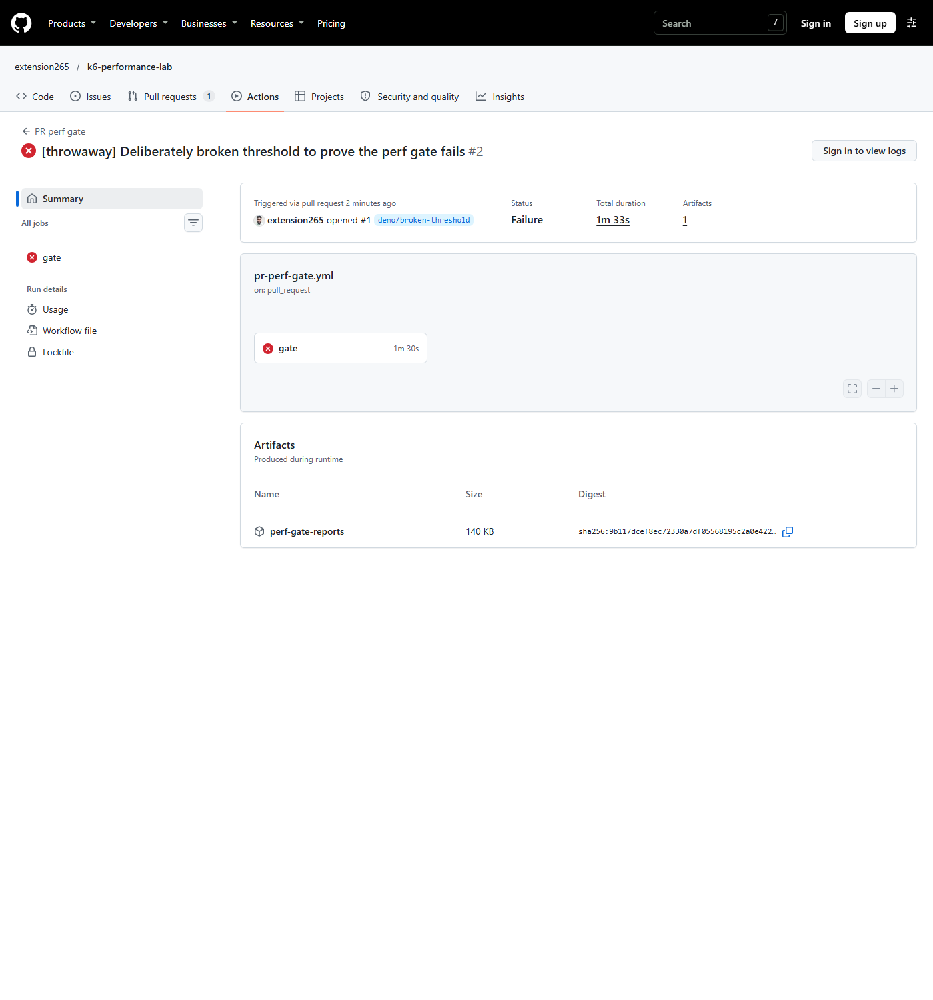

# k6 Performance Lab

<!-- One-line pitch + badges (CI status, k6, Docker) -->

## Key results

<!-- TODO: run and fill — before/after headline from docs/results.md + one Grafana screenshot -->

## Architecture

<!-- Mermaid diagram: k6 → API → Postgres; Prometheus → Grafana; CI flow -->

## Quick start

<!-- 3 commands max -->

## Test types

<!-- Table: what each scenario proves -->

## SLOs and thresholds

<!-- Thresholds and why they were chosen -->

## CI performance gate

Every pull request runs [`pr-perf-gate.yml`](.github/workflows/pr-perf-gate.yml) against postgres + api only (no monitoring stack):

1. **Newman contract:** all 133 assertions must pass.
2. **k6 smoke** (2 VUs, 30s) with the shared SLO thresholds. Any breach fails the job (k6 exit 99). This includes `idempotency_violations == 0`.
3. A results table goes to the job summary, and the reports are uploaded as artifacts.

**CI checks functional correctness under light load. It does not measure performance.** Latency numbers in CI come from shared GitHub-hosted runners, vary from run to run, and are never used as results. Controlled measurements live in [docs/results.md](docs/results.md).

The gate has been proven to fail. In throwaway [PR #1](https://github.com/extension265/k6-performance-lab/pull/1), the `POST /payments` p95 threshold was tightened to 1 ms. The check failed on the k6 smoke step, with that threshold the only one crossed. The PR was closed unmerged.

Also: [`load-test.yml`](.github/workflows/load-test.yml) (manual, any scenario) and [`publish-reports.yml`](.github/workflows/publish-reports.yml) (latest HTML reports on GitHub Pages).

## Reports and findings

<!-- Links to docs/results.md and GitHub Pages reports -->

## A note on the bottlenecks

<!-- The PayFlow API's bottlenecks are intentionally seeded and toggleable (BOTTLENECK_MODE) so the investigation is reproducible. -->
